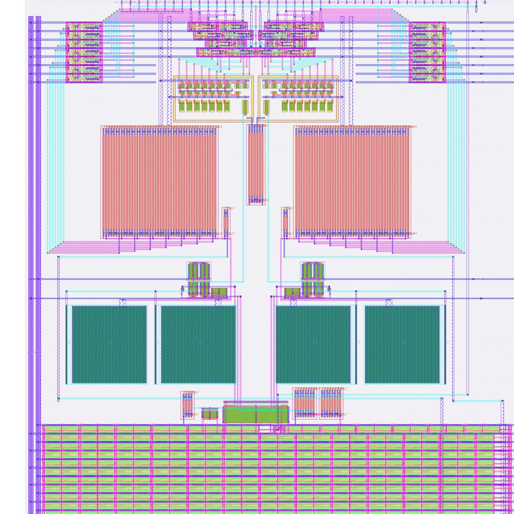

## How it works

This tile is a **pseudo-differential, second-order closed-loop VCO delta-sigma ADC**: two identical halves, one driven by VINP and one by VINN, whose digital outputs are subtracted off-chip. Each half is a feedback loop with two integrators: an OTA-C integrator and the ring oscillator itself (its phase integrates its frequency). The loop gives second-order noise shaping, and because the VCO only has to follow a small error signal, its nonlinear tuning curve is suppressed by the loop gain. Subtracting the two halves also cancels even-order distortion.

**Loop of one half (hand-drawn, sky130A 1.8 V devices)**

- The input (`ua[0]` = VINP, `ua[1]` = VINN) drives a 49 kΩ xhigh-poly resistor into the virtual ground of a 5-transistor OTA (NMOS input pair, DC gain about 42 dB). The OTA's non-inverting input sits at Vref = VDD/2 = 0.9 V.
- Two 24 µm × 25 µm MIM capacitors (about 2.4 pF in total) between the virtual ground and the OTA output form the integrator. An NMOS switch across them clears the integrator while `rst_n` is low.
- The OTA output (vctrl) sets the current of the **7-stage current-starved ring oscillator** through a V-to-I transistor on a 234 kΩ xhigh-poly resistor (one common-centroid array shared by both halves). Its value keeps the V-to-I transistor saturated over the whole vctrl range at every corner, so the tuning curve does not compress at the fast-NMOS corners.
- 7 flip-flops (`dfxtp_4`) sample the ring phases on every rising edge of `clk`; a second rank of 7 flip-flops holds the previous sample, and 7 XOR gates mark the stages that toggled in the last clock period.
- Each XOR bit drives one element of a **7-element resistor DAC** (1.04 MΩ per element, NRZ, rail to rail) back into the virtual ground. The DAC has no clock-dependent element selection: the ring's own rotation spreads the use over all elements, which first-order shapes their mismatch.
- Shared by both halves: the Vref divider with a MOS decoupling capacitor, the OTA tail bias (resistor into a diode-connected NMOS), and the `rst_n` inverter.

Full scale is about ±0.3 V per input around 0.9 V (±0.6 V differential), where the input current equals the full DAC current; the best SNDR is reached around ±0.15 V per input, and distortion rises above about ±0.2 V. At mid-scale the loop holds each ring at fs/4 (2.5 MHz at fs = 10 MHz) regardless of process corner, so the per-stage toggle limit (f_vco < fs/2) is met with margin.

**Outputs**

- P half: `uo_out[6:0]` are the sampled phases, `uo_out[7]` is the unsampled ring stage 0 (frequency monitor).
- N half: `uio_out[7:1]` are the sampled phases, `uio_out[0]` is the monitor (`uio_oe` is tied high, so all `uio` pins are outputs).

**Turning the phases into ADC codes (off-chip)**

For each half, XOR each 7-bit phase word with the previous one and count the ones:

`yP[n] = popcount(PHP[n] xor PHP[n-1])`, `yN[n]` likewise, and `y[n] = yN[n] − yP[n]`.

This is the same number of ones the on-chip DAC fed back, so `y` is the loop's digital output with second-order shaped quantization noise. The integrator inverts, so a higher VINP gives a *lower* yP; `y = yN − yP` has the input's sign. Low-pass filtering and decimating `y` gives the ADC output. The bit order of the phases does not matter.

## How to test

Required: a differential source for `ua[0]`/`ua[1]` around 0.9 V, and a way to capture `uo_out[7:0]` and `uio[7:0]` continuously at fs.

1. Select the project and give it a 10 MHz clock. Hold `rst_n` low for a few clock cycles, then release it (this clears the integrators) and wait about 30 µs for both loops to lock before capturing. `ui_in` is not used.
2. **Loop check:** apply 0.9 V to both inputs. Both monitors (`uo_out[7]`, `uio[0]`) should run at about fs/4, and the average code of each half should be about 3.5.
3. **ADC check:** apply VINP = 0.9 V + A·sin, VINN = 0.9 V − A·sin with A up to about 0.2 V and 1 kHz to 20 kHz. Capture all 16 outputs at every clock edge without gaps, for example with the RP2350 PIO and DMA (`test/capture_vco_adc.py` makes the clock and samples GPIO 25..40 in one state machine). Then run `test/decode_vco_adc.py` to get the spectrum and SNDR of each half and of the difference (the sign of the difference does not change the SNDR).

## External hardware

- A differential signal source or a DAC with two op-amp buffers for `ua[0]` and `ua[1]` (0.6 V to 1.2 V). The input resistance is about 49 kΩ to a virtual ground at 0.9 V, so the source should have well under 1 kΩ output impedance.
- Optional: a frequency counter or scope on `uo_out[7]` and `uio[0]`.
