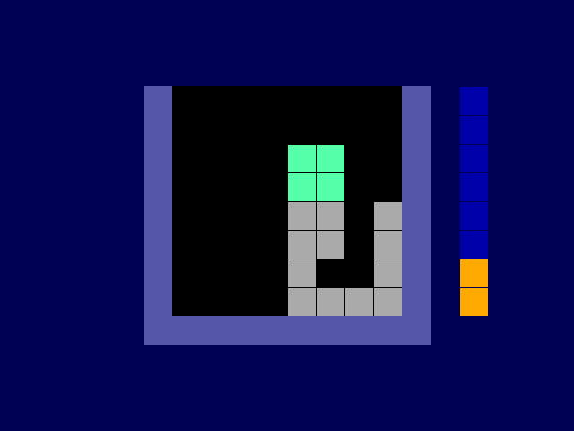

## How it works

**Blocos** is a small falling-block puzzle game that runs entirely in hardware:
there is no CPU and no software, only a state machine, a few counters and an
8x8 bit memory. Pieces fall into an 8-column, 8-row well; complete rows
disappear and the rows above drop down. The game ends when a new piece no
longer fits.

* **Board memory**: 8 rows x 8 bits of D flip-flops, one bit per cell. Row
  operations are plain bit logic: a row is full when all 8 bits are 1, a
  piece collides when `row & piece_mask` is not zero, and locking a piece is
  `row | piece_mask`.
* **Active piece**: kept in registers (type, rotation, x, y) and only written
  into the board when it lands. The 7 shapes x 4 rotations are a small
  combinational ROM of 4x4 masks.
* **Game state machine**: once per video frame (at the start of vertical
  blanking) it reads the buttons and tries one action: rotate, move left,
  move right or fall one row. The candidate position is checked one piece
  row per clock (4 clocks); if it collides it is rejected, and a blocked
  fall locks the piece, clears full rows (bottom to top) and spawns the next
  piece from an 11-bit LFSR.
* **Video**: 640x480 @ 60 Hz with no framebuffer. For every pixel the chip
  works out which 32x32 cell it belongs to and picks a colour from the board
  bit, the active piece, the well walls or the score column. 2 bits per
  colour channel (64 colours) on the TinyVGA PMOD.
* **Speed**: a piece falls one row every 31 frames (about half a second),
  one frame faster per line cleared, down to every 16 frames. Holding DOWN
  drops it every 3 frames.
* **Score**: lines cleared, shown in binary as 8 squares to the right of the
  well (most significant bit at the top) and on `uio_out`.

## How to test

1. Plug the TinyVGA PMOD into the output PMOD of the demo board and connect
   a VGA monitor.
2. Set the project clock to 25.175 MHz (25 MHz also works on most monitors)
   and reset the design. The empty well appears with the first piece at the
   top.
3. Play with the buttons on `ui_in` (active high, sampled once per frame,
   so no debouncing is needed):

   | Pin | Button |
   |---|---|
   | `ui[0]` | move left |
   | `ui[1]` | move right |
   | `ui[2]` | rotate |
   | `ui[3]` | hold to drop faster |

4. When the well fills up the blocks turn red; press any button to start a
   new game.

Without buttons, the DIP switches on `ui_in` also work (switch on, then off,
for one press). Optionally connect 8 LEDs to the bidirectional PMOD to see
the score in binary.

## External hardware

* TinyVGA PMOD (on the output PMOD) and a VGA monitor
* 4 push buttons on the input PMOD (or the demo board DIP switches)
* Optional: 8 LEDs on the bidirectional PMOD for the score
