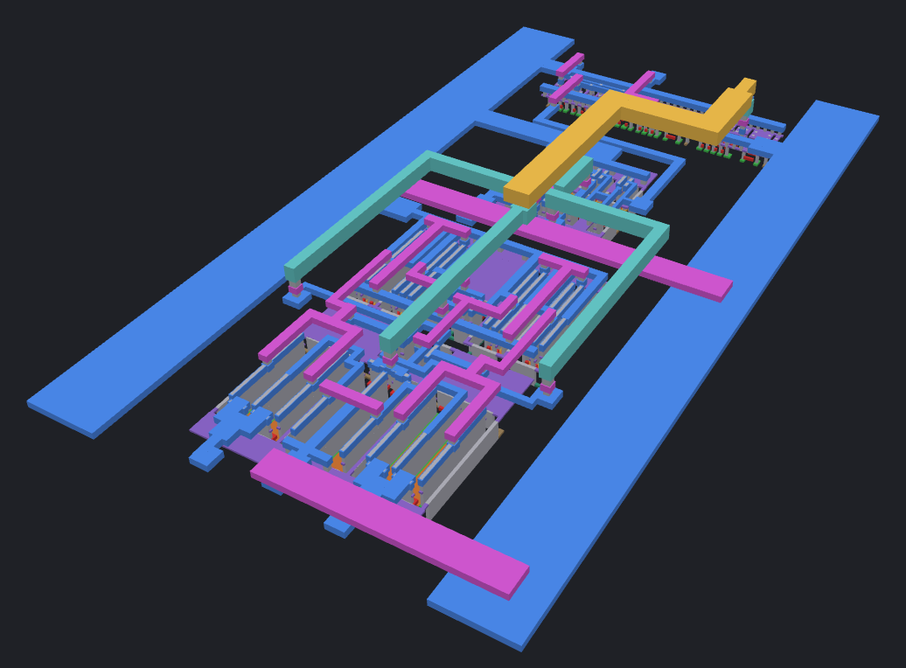
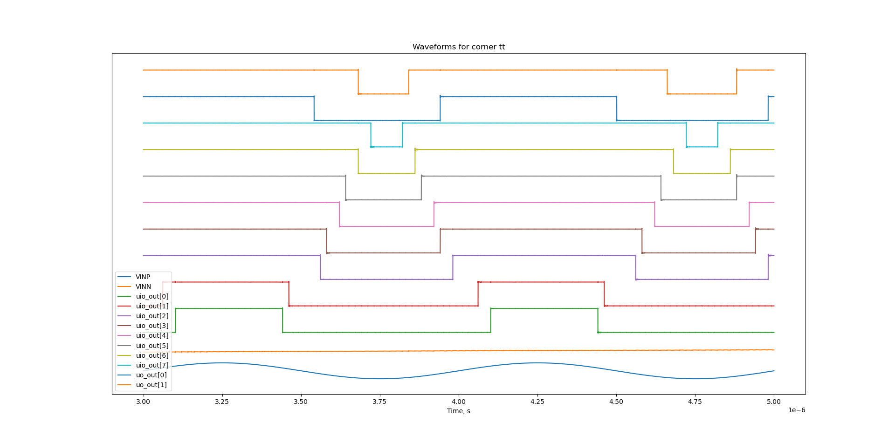

<!---

This file is used to generate your project datasheet. Please fill in the information below and delete any unused
sections.

You can also include images in this folder and reference them in the markdown. Each image must be less than
512 kb in size, and the combined size of all images must be less than 1 MB.
-->

## How it works

This design contains 3 components: a high speed comparator, a quasi-sigma delta front end for receiving AM radio (to be used in conjunction with this [AM radio project](https://tinytapeout.com/chips/ttsky25a/tt_um_jamesrosssharp_1bitam), and a flash converter. 

The comparator is a clocked strong arm latch type comparator with common mode input range 0.5 - 1.7 volts. 

The 1-bit frontend for the AM radio is simply the same comparator with external components to bias the positive input and allow a PWM signal to set the DC level at the negative input. It has been verified running at 250MHz clock speeds across temperature and process corner.

The flash converter consists of 8 comparators and a resistive ladder to set the reference level at the comparators' negative terminal. It therefore produces a thermometer code of the input voltage. It can be used as a low bit-count, high speed ADC.

The analog pins used are:

* ua[0] - positive input to comparator, antenna in, and flash converter input.
* ua[1] - negative input to comparator, or external cap for PWM

## How to test

A basic test might consist of connecting a voltage source at 1.1V to ua[1], and a sinusoid with 1.1V offset and 0.5V amplitude (1Vpp) to ua[0]. Apply a clock signal to the core. You should see the 8-bit thermometer coded values matching the sinusoid amplitude at uio_out[0:7] (uio_out[0] is MSB), and uio_o[0:1] should be square waves of corresponding frequency. Try sweeping the frequency up to the Nyquist rate and observe the output codes.

To test the PWM circuit, disconnect the voltage source from ua[1] and apply a PWM signal to to ui_in[0]. Measure the voltage at ua[1] and see if it corresponds to what you'd expect from the duty cycle of the PWM signal.

To test the AM radio, connect the PWM input (ui_in[0]) to the COMP_OUT of the AM radio, and the RF_FRONTEND_OUT (uo_out[0]) to the COMP_IN pin of the AM radio. Connect a 1nF cap to ua[1]. Then connect a long antenna wire (5meters or so) to ua[0]. If all goes well, you may be able to tune a few stations. But this submission is very much YOLO so the chances of it working are pretty slim.

## External hardware

* Signal generator
* Antenna wire
* 1 nF cap

