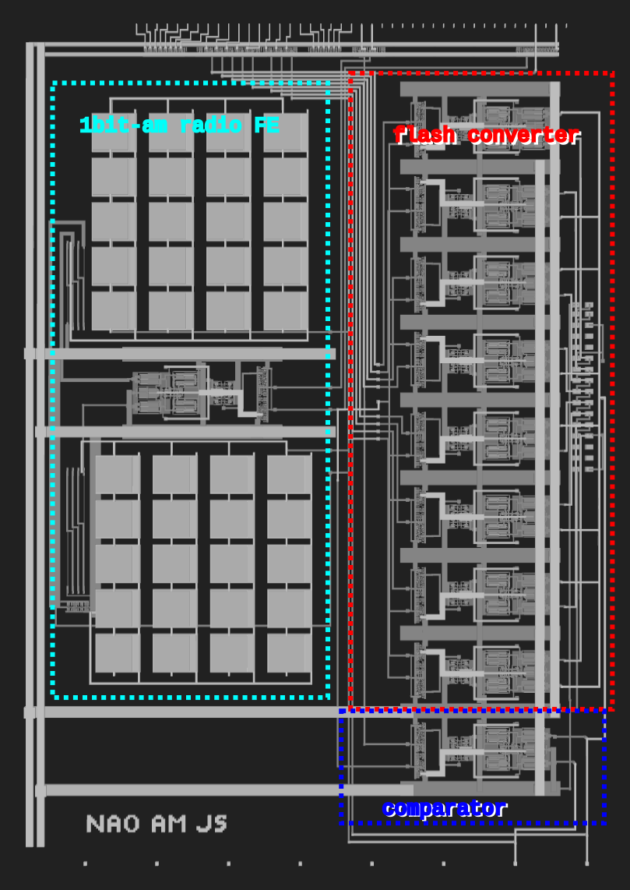
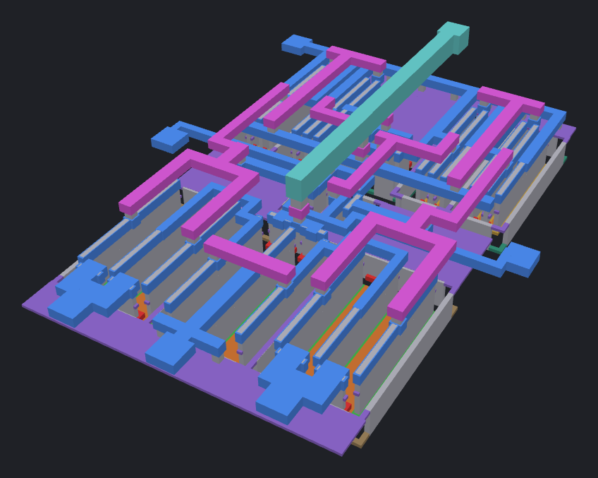
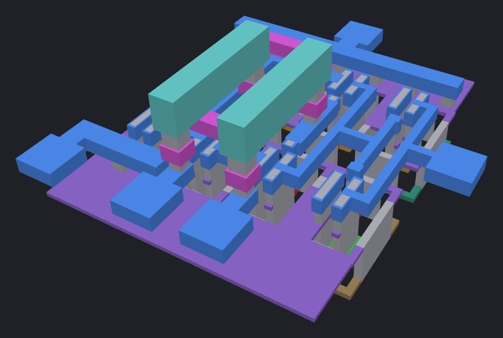
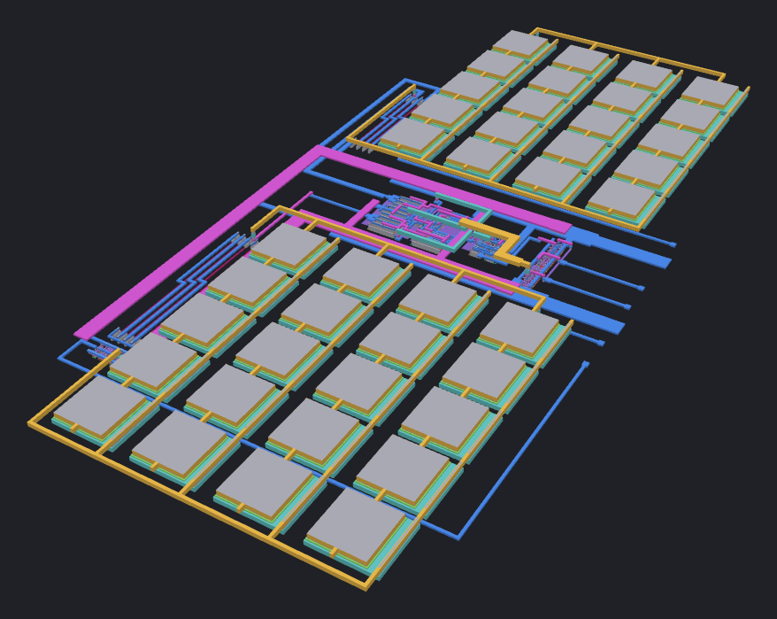
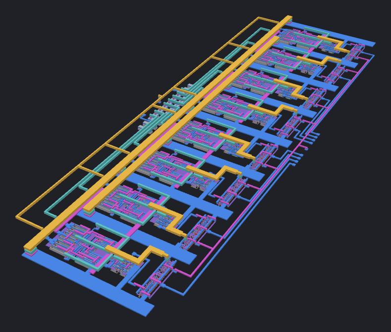

<!---

This file is used to generate your project datasheet. Please fill in the information below and delete any unused
sections.

You can also include images in this folder and reference them in the markdown. Each image must be less than
512 kb in size, and the combined size of all images must be less than 1 MB.
-->

## How it works

This design contains three blocks, all built around one clocked comparator:

1. A **high speed comparator**, brought out directly on the analog pins.
2. A **quasi-sigma-delta (1-bit) front end** for receiving AM radio. It is meant to work with this AM radio project: [https://tinytapeout.com/chips/ttsky25a/tt_um_jamesrosssharp_1bitam](https://tinytapeout.com/chips/ttsky25a/tt_um_jamesrosssharp_1bitam).
3. An **8-level flash converter** that produces a thermometer code.

Together that is ten copies of the same comparator. All of them are clocked from the Tiny Tapeout `clk` pin through a `clkbuf_16`. Every digital output goes through a `buf_4` before it reaches its pad.

The design files for this project are in this repository: [https://github.com/jamesrosssharp/magma](https://github.com/jamesrosssharp/magma). The design was routed using MagMa (MAgic MAnipulator) that reads and writes .mag files.

### High speed comparator

The comparator (25.0 × 43.5 µm) has three stages:

1. **StrongARM latch.** It runs from an inverted copy of the clock. The input pair and tail are low-Vt NMOS (`nfet_01v8_lvt`, W = 5 µm, L = 1 µm). The long channel keeps input offset low. The cross-coupled regenerative devices are minimum length, and four PMOS switches precharge the outputs and internal nodes to VDD while the clock is low.
2. **Post amplifier.** A small differential stage followed by an inverter. It turns the two latch outputs into one full-swing logic signal and isolates the latch from the flip-flop load.
3. **Output register.** A `sky130_fd_sc_hd__dfxtp_2` flip-flop captures the decision on the rising edge of `clk`, so the output stays valid for a full clock cycle. Expect one clock cycle of latency from input to output.

| StrongARM latch | Post amplifier |
|---|---|
|  |  |

The layout is symmetric about its vertical centre line, so both latch outputs see matched clock and ground coupling. Dummy devices sit at the ends of the device rows.

I ran post-layout Monte Carlo simulations on the extracted netlist: 100 runs per corner, a 50 MHz clock, a differential input stepped from −100 mV to +100 mV, and VDD, common mode and temperature randomised in each run.

| Corner | Working common-mode range | Avg power | Avg / worst propagation delay |
|---|---|---|---|
| tt | 0.46 – 1.7 V | 89 µW | 2.9 ns / 24.9 ns |
| ss | 0.51 – 1.7 V | 79 µW | 2.6 ns / 15.4 ns |
| fs | 0.51 – 1.7 V | 86 µW | 2.9 ns / 15.4 ns |
| sf | 0.44 – 1.7 V | 79 µW | 2.4 ns / 15.4 ns |
| ff | 0.44 – 1.7 V | 71 µW | 2.8 ns / 15.4 ns |

Every run passed from −54 to 94 °C with VDD between 1.7 and 1.9 V, provided the common mode was above the lower limit shown. That lower limit, about 0.45–0.5 V, comes from the NMOS input pair. As a rule of thumb, keep both inputs between **0.5 V and 1.7 V**.

### 1-bit AM radio front end

The front end uses the same comparator as a 1-bit quantiser in a delta-modulator style loop:

* **Input path.** The antenna signal on `ua[0]` is AC coupled through an on-chip MIM capacitor (C1, about 4 pF). Four equal high-resistance poly resistors bias the positive input at about VDD/2.
* **Feedback path.** The 1-bit bitstream on `ui_in[0]` (`PWM_IN`) is buffered by two inverters. It then drives an RC low-pass filter: four series `xhigh_po` resistors (a few hundred kΩ in total) into a second MIM capacitor (C2, about 4 pF). The filtered voltage drives the comparator's negative input. That node is also connected to `ua[1]`, so you can watch it, or add an external capacitor to lower the filter cutoff.
* **Loop.** The comparator compares the input with the filtered feedback, and the result appears on `uo_out[0]`. When that output is fed back to `PWM_IN` (off chip, through the AM radio design), the filtered bitstream tracks the input, so the bitstream encodes the RF signal.

The two 4 × 5 MIM capacitor arrays take up most of the block's area. The comparator sits between them.

I ran post-layout Monte Carlo simulations of this block with a **250 MHz clock** and a 20 mV sine input at about 100 MHz: 100 runs per corner, with VDD (1.65–1.93 V) and temperature (−43 to 104 °C) randomised. A run passes if the largest spectral peak of the output bitstream is in the same FFT bin as the input tone.

| Corner | tt | ss | fs | sf | ff |
|---|---|---|---|---|---|
| Pass rate | 100 % | 96 % | 100 % | 100 % | 99 % |
| Avg power | 245 µW | 205 µW | 231 µW | 263 µW | 309 µW |

### Flash converter

The flash converter has eight comparators. All eight positive inputs share `ua[0]`. Each negative input takes its reference from a tap on a resistive ladder. Together with extra resistors at the top level, the ladder has 12 equal resistors from VDD to ground, so comparator *k* trips when `ua[0]` is above (11 − k)/12 × VDD:

| Output | uio_out[0] | uio_out[1] | uio_out[2] | uio_out[3] | uio_out[4] | uio_out[5] | uio_out[6] | uio_out[7] |
|---|---|---|---|---|---|---|---|---|
| Threshold at VDD = 1.8 V | 1.65 V | 1.50 V | 1.35 V | 1.20 V | 1.05 V | 0.90 V | 0.75 V | 0.60 V |

The thresholds are 150 mV apart, and all of them fall inside the comparator's working common-mode range. The outputs form a thermometer code. `uio_out[7]` turns on first as the input rises, and `uio_out[0]` turns on last. Each output is registered by its own comparator's flip-flop, so all eight bits update on the same clock edge. There is no on-chip thermometer-to-binary encoder, so do that in the FPGA or microcontroller that reads the outputs.

The thresholds track VDD, because the ladder is tied to the supply.

### Pinout

| Pin | Name | Function |
|---|---|---|
| `ua[0]` | INP | Positive input of the standalone comparator, antenna input of the AM front end (AC coupled), and flash converter input |
| `ua[1]` | INN | Negative input of the standalone comparator. Also the AM front end's feedback-filter node, where an external capacitor can go. |
| `clk` | – | Sampling clock for all ten comparators |
| `ui_in[0]` | PWM_IN | 1-bit feedback bitstream for the AM front end |
| `uo_out[0]` | RF_FRONTEND_OUT | AM front end comparator output |
| `uo_out[1]` | COMP_OUT | Standalone comparator output (1 when `ua[0]` > `ua[1]`) |
| `uo_out[7:2]` | – | Tied low |
| `uio_out[7:0]` | FLASH_CONVERTER_x | Flash converter thermometer code. All `uio` pins are permanently outputs. |

`ena`, `rst_n`, `ui_in[7:1]` and `uio_in` are not used. Nothing is reset, so the outputs are only valid after the first few clock edges.

### Notes and known limitations

* `ua[1]` is shared between the standalone comparator's negative input and the AM front end's filter node. If you drive `ua[1]` from a voltage source, it overrides the PWM feedback, and the AM front end then behaves as a plain AC-coupled comparator against that voltage.
* The flash converter's reference ladder runs continuously from VDD to ground, so it draws static current whenever the design is powered.
* The flash converter has only been simulated at schematic level, not post layout.

## How to test

### Basic comparator and flash converter test

1. Connect a 1.1 V DC source to `ua[1]`.
2. Connect a sinusoid to `ua[0]`: 1.1 V offset, 0.6 V amplitude (1.2 Vpp).
3. Apply a clock (the design is specified at 50 MHz).

You should see:

* `uo_out[1]` (COMP_OUT): a square wave at the input frequency, high while `ua[0]` > 1.1 V.
* `uo_out[0]` (RF_FRONTEND_OUT): also a square wave at the input frequency. This input is AC coupled and re-biased to about 0.9 V, so expect the duty cycle to differ from COMP_OUT, and the output to stop toggling at low frequencies (below a few hundred kHz).
* `uio_out[7:0]`: a thermometer code that follows the sinusoid's amplitude. With a 0.5–1.7 V swing, the outputs from `uio_out[7]` (0.60 V threshold) to `uio_out[0]` (1.65 V threshold) should toggle.

Then sweep the input frequency up towards the Nyquist rate (half the clock frequency) and watch the output codes. You can also raise the clock frequency to find where the comparators stop resolving. The AM front end was simulated at 250 MHz, although the Tiny Tapeout I/O pads will limit the clock and output speed you can see off chip.

To measure the standalone comparator's offset, set `ua[1]` to a fixed voltage, slowly ramp `ua[0]` through it, and note where `uo_out[1]` switches. Repeat at several common-mode voltages between 0.5 V and 1.7 V.

### PWM feedback filter test

Disconnect the voltage source from `ua[1]` and apply a PWM signal to `ui_in[0]`. Measure the voltage at `ua[1]` with a high-impedance probe, because the on-chip filter has a source impedance of several hundred kΩ. The voltage should be about the duty cycle × VDD. Adding a capacitor (for example 1 nF) from `ua[1]` to ground lowers the ripple.

### AM radio test

1. Connect the PWM input (`ui_in[0]`) to COMP_OUT of the AM radio project.
2. Connect RF_FRONTEND_OUT (`uo_out[0]`) to the COMP_IN pin of the AM radio.
3. Connect a 1 nF capacitor from `ua[1]` to ground.
4. Connect a long antenna wire (about 5 m) to `ua[0]`.

If all goes well, you may be able to tune in a few stations. This submission is very much YOLO, though, so the chances of it working are pretty slim.

## External hardware

* Signal generator (DC source and sine source)
* Oscilloscope or logic analyser for the outputs
* Antenna wire (about 5 m)
* 1 nF capacitor
* FPGA running the [1-bit AM radio](https://tinytapeout.com/chips/ttsky25a/tt_um_jamesrosssharp_1bitam) design, or a Tiny Tapeout sky25a dev kit, for the radio test
