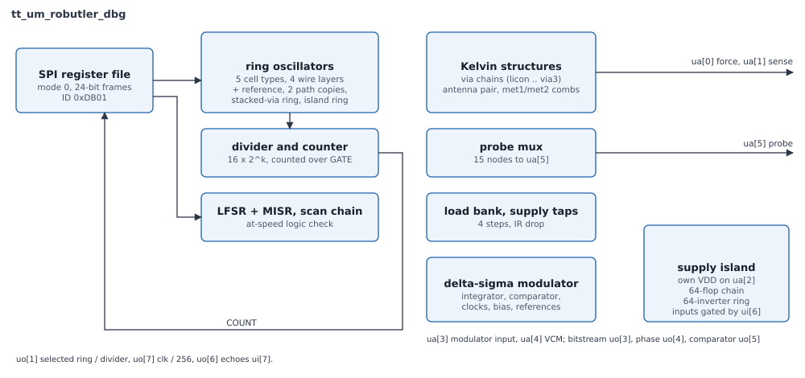
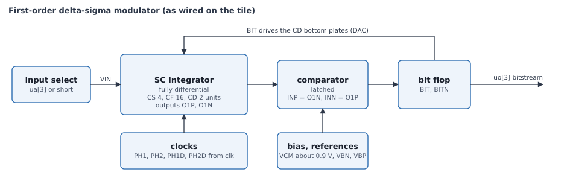
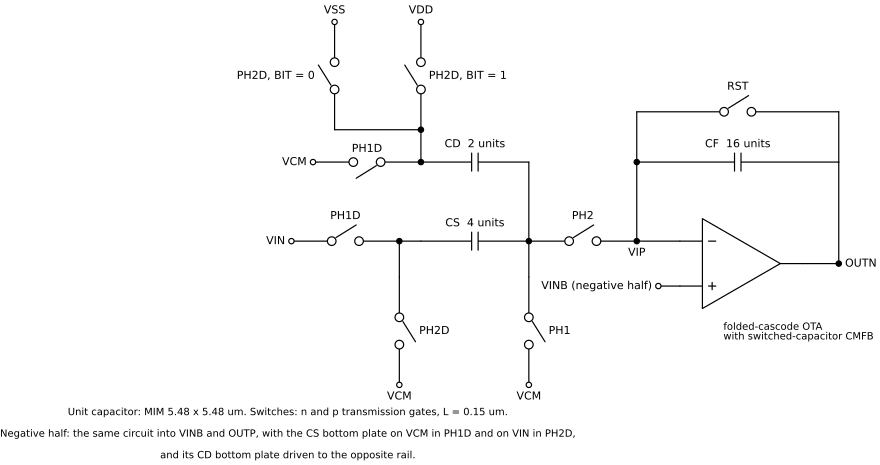
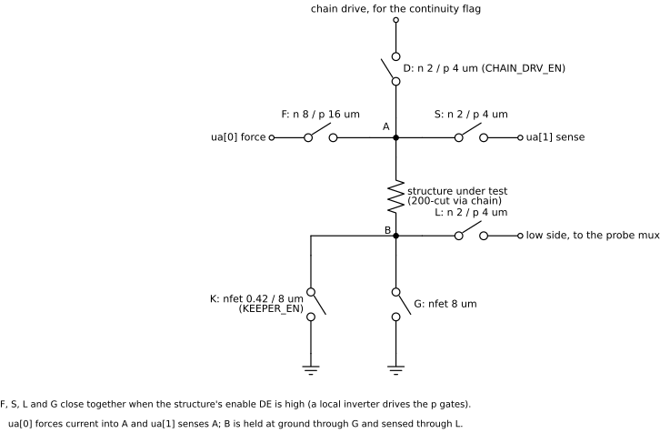
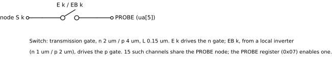
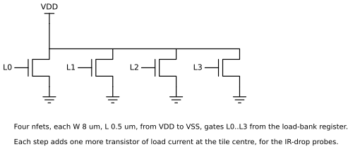
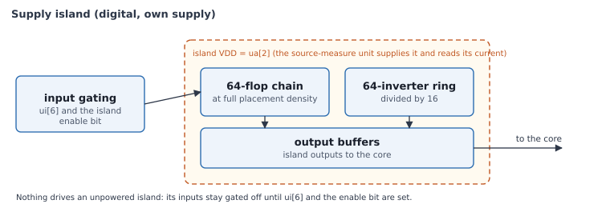
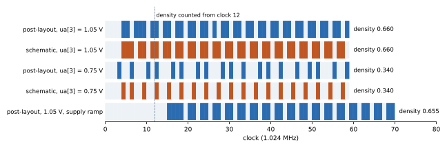
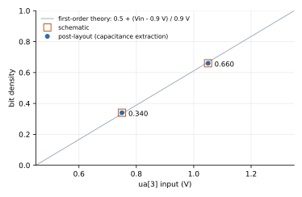
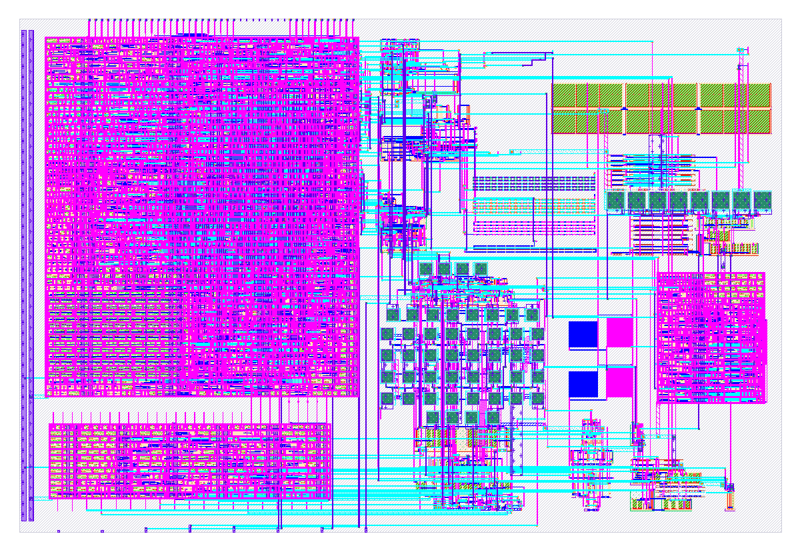

## How it works

This tile holds test structures for the REDA chip design flow. Each structure is built by one step of the flow, so a measured
fault points at the step that made it. Everything is read through a small SPI register file clocked by `clk`.

- Ring oscillators: five rings of one cell type each (inv_1, inv_4, nand2_1, nor2_1, clkinv_4, 31 stages), four rings with
  60 um of wire per stage on met1, met2, met3 and met4 plus an unloaded reference, two rings that copy the two slowest
  register paths of a REDA-built digital design, a ring whose wires are forced through stacked vias on every metal, and a
  65-stage ring on the separate island supply. One ring at a time drives a divider (16 x 2^k) to `uo[1]` and to a counter
  that counts its edges over a window of `clk` cycles.
- A 16-bit LFSR and signature register (MISR) for an at-speed check of the synthesised logic.
- A scan chain through all of the control logic (`ui[3]`, `ui[4]`, `uo[2]`, with `ui[5]` high), on a REDA-built clock tree.
- Via chains of 200 cuts each (licon on poly with mcon, via, via2, via3) with digital continuity flags on `uio[0..3]` and
  four-wire (Kelvin) access through `ua[0]` and `ua[1]`.
- An antenna pair: two identical nfets, one with its gate on a long met3 line close to the antenna limit, one on a short line.
- Two minimum-space met1/met2 combs with a short flag and Kelvin leakage access.
- A supply island on `ua[2]` with a 64-flop chain and an inverter chain at full placement density.
- Supply taps at the tile centre and edge, and a 4-step load bank, for IR drop through the probe pin `ua[5]`.
- A first-order delta-sigma modulator built from copies of the blocks of the modulator in tt_um_robutler_dsm on this
  shuttle (clock generator, bias, references, decoder, comparator, input selector) and an integrator replica.
  The integrator replica uses the same circuit, capacitor ratios, layout generator, device cells, router and extraction as
  the modulator in tt_um_robutler_dsm on this shuttle, so it shares their systematic errors; it is a separate layout with
  half-size capacitors.
  Its bitstream is on `uo[3]`, its sampling phase on `uo[4]` and the comparator's latch output on `uo[5]`.
- `uo[7]` toggles at `clk` / 256 with no other dependency, and `uo[6]` echoes `ui[7]` through one buffer.

SPI: mode 0, 24-bit frames (write bit, 7 address bits, 16 data bits), SCK at most `clk` / 8, reply in the next frame.
The first read after reset returns the ID 0xDB01.

Expected values for the test structures: expected.json, sha256 `527fc5deae4dab6550b1041ae0687444a1804d48538d8bb63ee182c7c1d9a7c6`.

## How to test

The bring-up programs in `test/bringup/` do every step below on Tiny Tapeout's demo board (`board.py`, MicroPython), and
the same programs run in simulation on the gate-level netlist (`test/bringup/twin/`). This section is what they do.

**Clock, reset and SPI.** Drive `clk` at 1.024 MHz and hold `rst_n` low for at least 3 cycles. SPI is mode 0 on `ui[0]`
SCK, `ui[1]` SDI, `ui[2]` CS_N and `uo[0]` SDO, MSB first, 24-bit frames: a write bit, 7 address bits, 16 data bits. SCK at
most `clk` / 8, CS_N high for at least 4 clocks between frames. The reply to a frame comes out during the next frame: the
address byte it answers (with the write bit for a write), then the register's 16 bits. So a read is two frames of the same
read address, and a write followed by one read frame returns the value as written. The first reply after reset is the ID.

| Addr | Register | Bits |
|---|---|---|
| 0x00 | ID (read) | 0xDB01 |
| 0x01 | CTRL | [4:0] ring select (0 = none), [11:8] divider k, [12] count start, [13] count clear, [14] island enable, [15] signature run |
| 0x02 | GATE | count window in clock cycles (counts down; write it before every count) |
| 0x03 | COUNT (read) | rising edges of the divided ring in the window |
| 0x04 | MISR_SEED | the LFSR: write the seed; reads its state |
| 0x05 | MISR_LEN | run length in clock cycles (counts down) |
| 0x06 | MISR_SIG (read) | the signature |
| 0x07 | PROBE | [3:0] node on `ua[5]`: 1 O1P, 2 O1N, 3 VCM, 4 VBN, 5 VBP, 6 VCN, 7 VCP, 8 VDHI, 9 VDLO, 10 to 13 supply taps (VPWR centre, VPWR edge, VGND centre, VGND edge), 14 Kelvin low node, 15 path from `ua[0]`; 0 off |
| 0x08 | MODE | [3:0] Kelvin structure (1 to 4 via chains licon+mcon, via, via2, via3; 5, 6 antenna devices A and B; 7, 8 combs), [4] `ua[3]` on the antenna gates, [5] keepers, [6] chain driver on, [7] driven level |
| 0x09 | STATUS (read) | [3:0] via chain far ends, [5:4] comb short flags, [7] island chain output, [8] island active, [9] `ui[6]`, [10] `ui[5]`, [11] count overflow, [12] signature busy, [13] signature done, [14] count busy, [15] count done |
| 0x0A | SCRATCH | [7:0] |
| 0x0B | CTRL2 | [3:0] load steps, [4] dither, [5] modulator power up, [6] modulator input to VCM, [7] routing-stress ring to `uio[7]`, [9:8] island chain input (0, 1, clk/16, LFSR), [10] island chain into the signature |

Other pins: `ui[3]` scan enable, `ui[4]` scan in, `ui[5]` test mode (hold low in use), `ui[6]` island I/O enable, `ui[7]`
echo in; `uo[1]` selected ring divided, `uo[2]` scan out, `uo[3]` modulator bit, `uo[4]` its sampling phase, `uo[5]` the
comparator, `uo[6]` echo, `uo[7]` `clk` / 256; `uio[0..3]` via chain ends, `uio[4]` comb short, `uio[5]` signature done,
`uio[6]` island chain output, `uio[7]` routing-stress ring / 4096.

**The programs, in order:**

1. `p1_registers`: the first frame after reset returns 0xDB01; every register reads its reset value (0 except the ID);
   SCRATCH, GATE, MISR_SEED, MISR_LEN, PROBE, MODE, CTRL2 and CTRL read back written patterns; writes to ID, COUNT,
   MISR_SIG and unused addresses change nothing; a 23-bit frame is ignored and the next reply starts with 0xEE; `uo[6]`
   follows `ui[7]`; with the clock single-stepped, `uo[7]` rises every 256 clocks.
2. `p2_rings`: for each ring 1 to 16, write CTRL with the ring and its divider k (`expected_values.json`), GATE, wait 40
   clocks, set count start, wait GATE + 8 clocks, read STATUS and COUNT. f = COUNT x 16 x 2^k x 1.024 MHz / GATE. Ring 16
   is on the island: source 1.8 V on `ua[2]` (4 mA limit) and set `ui[6]` first. With no ring selected COUNT stays 0.
3. `p3_signature`: for each (seed, length) of `expected_values.json`: write CTRL2 = 0, MISR_SEED, MISR_LEN, set the run
   bit, wait the length + 8 clocks; STATUS shows done, `uio[5]` is high, MISR_SIG and MISR_SEED equal the model.
4. `p4_scan`: stop the free-running clock, set `ui[5]` and `ui[3]`, shift 192 known bits in on `ui[4]` with one clock step
   each, then shift 200 more steps reading `uo[2]`: the 192 bits come out in order, then zeros. Clear `ui[3]` and `ui[5]`,
   restart the clock, reset, and read the ID.
5. `p5_chains_combs_antenna`: MODE = keepers + chain driver at level 1, then 0: STATUS[3:0] and `uio[3:0]` read 0xF,
   then 0x0. With MODE = 0 the comb flags STATUS[5:4] and `uio[4]` read 0. MODE = 0x15 and 0x16 put antenna device A and B
   on the Kelvin pins with `ua[3]` on their gates: sweep `ua[3]` from 0 to 1.8 V and read the drain current on `ua[0]`.
6. `p6_island`: source `ua[2]` first. CTRL2 chain input = 1 and the island enable bit: STATUS[8] stays 0 until `ui[6]` is
   set. Then after 148 clocks STATUS[7] and `uio[6]` read 1; with input 0 they read 0; with input 1 folded into the
   signature (CTRL2 = 0x0500), seed 0x5EED and length 500 give the model's signature.
7. `p7_load_probe`: PROBE 0 to 15 read back; for PROBE 10 to 13, CTRL2 load = 0, 1, 3, 7, 15 (0 to 4 steps): read `ua[5]`
   at each point. The voltage change per step over the step current is the supply grid resistance to that tap.
8. `p8_modulator`: set `ua[3]` (for example 1.05 V or 0.75 V, DC through at most 500 ohm), write CTRL2 = 0x0020 (power up,
   dither off, input not shorted), capture `uo[3]` on 4,096 rising edges of `uo[4]` after 12 clocks: the density of ones
   is inside 0.617 to 0.717 at 1.05 V and 0.283 to 0.383 at 0.75 V.

## External hardware

A source-measure unit with two channels (Kelvin force and sense, and the island supply), and the demo board's
microcontroller for SPI and the counters.

## Results

Designed with REDA on Robutler (https://robutler.ai). Layout, routing, extraction and sign-off below are REDA's, on sky130A,
except the Tiny Tapeout precheck, which is Tiny Tapeout's own.

| Check | Result |
|---|---|
| Tiny Tapeout precheck (tt-support-tools 21568ef7, and the GitHub action) | pass: 17 checks, 0 failures, 0 errors; Magic full DRC count 0 |
| DRC | 0 findings, with certificate replay accepted (445 of 456 rules judged) |
| LVS | match, certificate accepted: 18,796 layout devices, 9,617 nets, including the island supply |
| Antenna | 0 violations; the antenna-pair witness sits at about 92 % of the limit by design |
| Static timing of the two digital blocks (core and supply island), with signal integrity | met at ss, tt and ff; worst hold +16.3 ps (core) and +12.1 ps (island), both at ff |
| Gate-level simulation of the digital blocks with extracted delays (SDF) | cocotb 8 of 8 tests pass at tt, ss and ff |
| RTL simulation | cocotb 9 of 9 tests pass |
| Delta-sigma modulator, post-layout (tt, capacitance extraction) | bit density 0.660 at 1.05 V and 0.340 at 0.75 V input, equal to the schematic; clean start on the supply ramp |

The analog top is checked by LVS and the post-layout modulator simulation, not by gate-level simulation. Extraction is
capacitance only, so timing and modulator results do not include wire resistance. The ss side of the probe-voltage bands is
not judged, and the supply taps (PROBE 10 to 13) have no expected value. The expected values for the other structures are in
expected.json (sha256 above).

### Bring-up programs in simulation

The programs of "How to test", run in the simulation twin: the gate-level netlists of the two digital blocks with the
SDF of each corner (interconnect delays left out), Icarus Verilog, clk 1.024 MHz, analog blocks as behavioural stand-ins. See
`docs/bringup-results.md` for every number.

| Program | tt 25 C 1.80 V | ss 100 C 1.60 V | ff -40 C 1.95 V |
|---|---|---|---|
| `p1_registers` | PASS (49 of 49 checks) | PASS (49 of 49 checks) | PASS (49 of 49 checks) |
| `p2_rings` | PASS (17 of 17 checks) | PASS (17 of 17 checks) | FAIL (1 of 17 checks) |
| `p3_signature` | PASS (7 of 7 checks) | PASS (7 of 7 checks) | PASS (7 of 7 checks) |
| `p4_scan` | PASS (3 of 3 checks) | PASS (3 of 3 checks) | PASS (3 of 3 checks) |
| `p5_chains_combs_antenna` | PASS (7 of 7 checks) | PASS (7 of 7 checks) | PASS (7 of 7 checks) |
| `p6_island` | PASS (5 of 5 checks) | PASS (5 of 5 checks) | PASS (5 of 5 checks) |
| `p7_load_probe` | PASS (37 of 37 checks) | PASS (37 of 37 checks) | PASS (37 of 37 checks) |
| `p8_modulator_1.05V` | PASS (2 of 2 checks) | PASS (2 of 2 checks) | PASS (2 of 2 checks) |
| `p8_modulator_0.75V` | PASS (2 of 2 checks) | PASS (2 of 2 checks) | PASS (2 of 2 checks) |

The ring frequencies in the twin come from the SDF cell delays without the interconnect delays, so they run fast: at tt, 3 to 9 % above the static-timing value for the 31-stage rings, the path replicas and the island ring, and 16 to 26 % for the 15-stage rings (6 to 10 and 13 to 15), whose stages are fastest so the missing wire delay is a larger share (ring 10, met4, is the largest). At ff that puts every ring above the band, whose upper edge is the ff static-timing value with the interconnect delays: the FAIL at ff is the twin's missing wire delay, not a prediction for silicon. Every ring oscillates at every corner, and with no ring selected COUNT stays 0. On the board the programs judge silicon against the static-timing band.

## Figures

*Block diagram of the tile, drawn from this datasheet.*

*The first-order delta-sigma modulator as wired on the tile: comparator input INP on O1N and INN on O1P.*

*Switched-capacitor integrator, positive half, drawn from the integrator's SPICE netlist (device sizes and capacitor units as in the netlist).*

*One Kelvin-switched structure (a 200-cut via chain), drawn from the Kelvin switch netlist. The antenna pair and the combs use the same switch cell.*

*One channel of the 15-channel probe multiplexer, from its netlist.*

*Load bank for the IR-drop probes, from its netlist.*

*Supply island: a digital block on its own supply, ua[2].*

*Modulator bitstreams from SPICE (ngspice 45), sky130 tt models, 27 C, 1.8 V, 1.024 MHz clock. Post-layout runs use the extracted netlist (capacitance only, no wire resistance); schematic runs are shown for comparison. Bit density from clock 12: 0.660 at 1.05 V and 0.340 at 0.75 V in both; 0.655 with the supply ramp at start-up.*

*Bit density against the ua[3] input, same runs and conditions, with the first-order line for a full scale of plus or minus VDD/4 around VCM = 0.9 V.*

*Layout of the 2x2 tile (334.88 x 225.76 um), all layers, rendered with KLayout from gds/tt_um_robutler_dbg.gds.*
