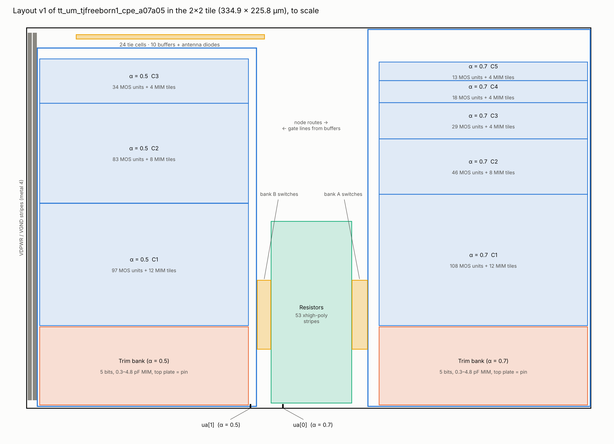
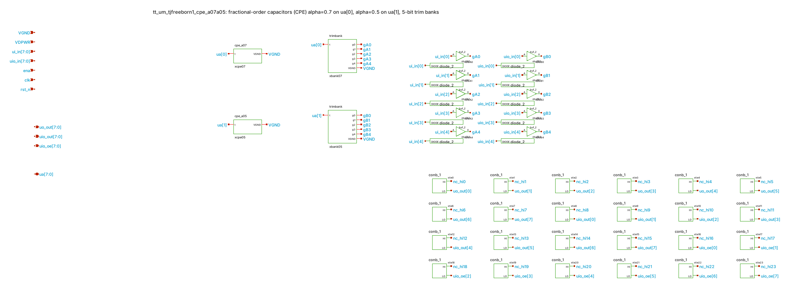

<!---

This file is used to generate your project datasheet. Please fill in the information below and delete any unused
sections.

You can also include images in this folder and reference them in the markdown. Each image must be less than
512 kb in size, and the combined size of all images must be less than 1 MB.
-->

## How it works

This project contains two passive approximations of fractional-order capacitors, also referred to as constant phase
elements (CPEs), connected to the analog pins `ua[0]` and `ua[1]`. The impedance of an ideal fractional-order
capacitor is given by:

$$Z(j\omega) = \frac{1}{(j\omega)^{\alpha} C_{\alpha}} \qquad (1)$$

where ω is the angular frequency in rad/s, α is the order (0 < α < 1), and Cα is the pseudocapacitance with units
F·s^(α−1)^. The phase of (1) is −90α° at all frequencies, which places the fractional-order capacitor between a
resistor (α = 0, 0°) and a capacitor (α = 1, −90°), and (1) becomes the familiar capacitor impedance 1/(jωC) when
α = 1. Fractional-order capacitors are widely used to realize fractional-order filters, oscillators, and
controllers, and to model the impedance of electrodes, batteries, and biological tissues. For reference, the Cα
values in this work correspond to a measured |Z| of approximately 260 kΩ for `ua[0]` and approximately 130 kΩ for
`ua[1]` at 10 kHz.

- `ua[0]`: α = 0.7 element, with a target phase of −63°.
- `ua[1]`: α = 0.5 element, with a target phase of −45°.

Note that `ua[0]` and `ua[1]` are the analog pins of this project, and the physical chip pin that each one reaches
depends on the position of the project on the Tiny Tapeout (TT) shuttle (the pin numbers for a specific chip are given on the project
page at tinytapeout.com).

### Definitions

The following terms are used throughout this datasheet.

- **Constant phase band:** the frequency range over which the measured phase remains within ±2.5° of −90α°. This is
  the main performance metric of this work, as an RC network can only maintain a constant phase over a limited band.
- **Decades:** the width of the constant phase band on a logarithmic scale, calculated as $\log_{10}(f_{high}/f_{low})$,
  so that 3 decades corresponds to a 1000:1 range (e.g. from 1 kHz to 1 MHz).
- **Trim code:** the 5-bit value (from 0 to 31) applied to the input pins of this project, which adds a small
  capacitance to each element and is selected once for each chip during measurement (step 6 of the procedure) to
  maximize the constant phase band.
- **Pin path:** the connection between the on-chip network and the package pin (the TT analog switch,
  on-chip analog bus, and pad). The pin path adds a series resistance from 35 Ω to 500 Ω and a capacitance to ground
  of approximately 4 pF on chip (from 4 pF to 9 pF including the board), which this design includes as part of the
  network.
- **Process corners:** the extremes of manufacturing variation, where tt is typical, ss and ff are slow and fast
  transistors, and sf and fs are the mixed cases.
- **Monte Carlo:** simulation of many randomly varied chips, where mismatch is the random difference between nominally
  identical devices on the same chip and σ is the standard deviation.

### Design

Each element is realized as a Morrison–Valsa network [1, 2], which is a resistor (Rp) in parallel with several series
resistor-capacitor branches whose values are spaced so that their combined phase ripples only slightly around the
target. The networks are realized using SKY130 high-resistance polysilicon resistors and MOS plus MIM capacitors, with
a total of approximately 200 pF per element.

Each element also includes a 5-bit trim bank (described under Circuit) to compensate for chip-to-chip differences in
the pin capacitance and process. The drawn steps are 0.3 pF (from 0 pF to 9.3 pF), though the extracted layout yields
steps of approximately 0.34 pF (from 0 pF to 9.5 pF) as a result of additional parasitic capacitance.

The MOS capacitors require a DC bias of at least approximately 0.5 V on the pin, which is supplied by the impedance
analyzer. Further, changing this bias from 0.7 V to 1.5 V changes the MOS capacitor values and tunes Cα by
approximately 8%.

The simulated performance of both elements, using the extracted layout, the best trim code for each chip, and the
worst case of 12 pin path models, is given in the following table. The band rows for the median chip, 99% of chips,
and worst chip are from the Monte Carlo analysis, while the band common to every simulated case is from the corner
analysis (both are described under Verification details). Note that Cα is fitted together with α, so its units
follow the fitted α (for example nF·s^−0.287^ for `ua[0]`), and the table labels them with the nominal α for
readability.

| Metric | `ua[0]`, α = 0.7 | `ua[1]`, α = 0.5 |
|---|---|---|
| Band within ±2.5°: median chip | 4.32 decades | 2.33 decades |
| Band within ±2.5°: 99% of chips at least | 4.28 decades | 2.29 decades |
| Band within ±2.5°: worst chip | 3.96 decades | 1.99 decades |
| Band within ±3°: median / worst chip | 4.38 / 4.32 decades | 2.38 / 2.34 decades |
| Band common to every simulated case (±2.5°) | 4.12 decades, 126 Hz to 1.68 MHz | 2.12 decades, 1.9 kHz to 251 kHz |
| Fitted α | 0.713 | 0.500 |
| Cα at 1.0 V bias, typical ± 1σ | 1.66 nF·s^−0.3^ ± 1.1% | 30.1 nF·s^−0.5^ ± 2.3% |
| Cα, range over all corners | 1.56 to 1.76 nF·s^−0.3^ | 26.2 to 32.4 nF·s^−0.5^ |

### Circuit

The network connected to each pin is given in the following figure. It consists of a parallel resistor (Rp) and N
branches of a resistor (Rk) in series with a capacitor (Ck), all connected from the pin to ground, with the trim bank
in parallel (N = 5 for α = 0.7 on `ua[0]` and N = 3 for α = 0.5 on `ua[1]`). Trim bit k is set by `ui_in[k]` for
`ua[0]` and by `uio_in[k]` for `ua[1]` (bit 0 is the least significant bit), where a set bit closes the corresponding
NMOS switch and adds a drawn capacitance of 0.3 pF × 2^k^.

![Morrison–Valsa network and 5-bit trim bank connected to each analog pin (N = 5 for ua[0] and N = 3 for ua[1], drawn trim capacitances from 0.3 pF to 4.8 pF)](network.png)

The resistor and capacitor values of each branch, as laid out, are given in the following tables for `ua[0]` and
`ua[1]`, respectively. Each Ck is realized as a number of 10 µm × 10 µm MOS capacitor units (approximately 0.76 pF
each at 1.0 V bias) in parallel with a MIM capacitor, and the number of units and the MIM capacitance are given in
parentheses. For example, C1 of `ua[0]` is 100.2 pF, realized as 108 MOS units in parallel with 18.2 pF of MIM
capacitance.

| `ua[0]`, α = 0.7 | Rk | Ck (MOS units + MIM) |
|---|---|---|
| R1, C1 | 3.94 MΩ | 100.2 pF (108 units + 18.2 pF MIM) |
| R2, C2 | 1.25 MΩ | 42.4 pF (46 units + 7.5 pF MIM) |
| R3, C3 | 331 kΩ | 26.9 pF (29 units + 4.9 pF MIM) |
| R4, C4 | 85.8 kΩ | 16.5 pF (18 units + 2.9 pF MIM) |
| R5, C5 | 15.5 kΩ | 12.3 pF (13 units + 2.4 pF MIM) |
| Rp | 18.0 MΩ | n/a |

| `ua[1]`, α = 0.5 | Rk | Ck (MOS units + MIM) |
|---|---|---|
| R1, C1 | 591 kΩ | 90.5 pF (97 units + 16.9 pF MIM) |
| R2, C2 | 222 kΩ | 76.8 pF (83 units + 13.8 pF MIM) |
| R3, C3 | 51.0 kΩ | 31.9 pF (34 units + 6.1 pF MIM) |
| Rp | 682 kΩ | n/a |

- **Devices (SKY130 cells):**
  - Resistors: `sky130_fd_pr__res_xhigh_po_0p35` (0.35 µm wide), with R ≈ 5.71 kΩ/µm × L + 0.62 kΩ per segment.
  - MIM capacitors: `sky130_fd_pr__cap_mim_m3_1`.
  - MOS capacitors: `sky130_fd_pr__nfet_01v8`, with the gate on the branch node and the source, drain, and body
    connected to ground.
  - Trim switches: `sky130_fd_pr__nfet_01v8`.
- **Trim bank:** binary-weighted MIM capacitors. The pin path capacitance (from 4 pF to 9 pF) supplies the remainder
  of the capacitance that sets the upper end of the band.
- **Size:** 2 × 2 tiles (334.9 µm × 225.8 µm), with the α = 0.5 element on the left, the α = 0.7 element on the
  right, and the resistor array and trim switches in the center.

The simulated impedance magnitude and phase of both elements from 20 Hz to 10 MHz, using the extracted layout at the
typical corner with 1.0 V bias and the nominal 100 Ω / 6.5 pF pin path model, are given in the following figure for
`ua[0]` (blue, trim code 11) and `ua[1]` (orange, trim code 14). The phase of each element ripples around its target
(dashed lines at −63° and −45°) over the constant phase band, approaches 0° at the lowest frequencies where Rp
dominates, and approaches −90° at the highest frequencies where the pin capacitance dominates. For these conditions,
`ua[0]` remains within ±2.5° of −63° over 4.34 decades and `ua[1]` remains within ±2.5° of −45° over 2.34 decades,
which is very close to the Monte Carlo medians of 4.32 decades and 2.33 decades, respectively.

![Simulated impedance magnitude and phase of ua[0] (α = 0.7, trim code 11, blue) and ua[1] (α = 0.5, trim code 14, orange) from the extracted layout at the typical corner with 1.0 V bias and a 100 Ω / 6.5 pF pin path model](bode.png)

The layout of the project and the top-level Xschem schematic are given in the following two figures, respectively.

### Verification details

- **Corner analysis:** a total of 69 combinations of process corner, bias (0.7 V, 1.0 V, and 1.5 V), and temperature
  (from 0 °C to 70 °C) were simulated, each with 12 pin path models (series resistance of 35 Ω, 100 Ω, 300 Ω, or
  500 Ω and pin capacitance of 4 pF, 6.5 pF, or 9 pF), for a total of 828 cases per element.
- **Monte Carlo:** a total of 500 chips were simulated (300 at the typical MOS corner and 50 at each of the ss, ff,
  sf, and fs corners). Each chip included device-to-device mismatch and chip-wide resistor and MIM variation (with 3σ
  equal to the PDK corners), and was evaluated using its own best trim code and the worst of the 12 pin path models.
- **Tail of the band distribution:** the small tail is attributed to the in-band phase ripple, which peaks at
  approximately ±2.2° (close to the ±2.5° limit). In approximately 1% of chips, mismatch pushes one ripple peak past
  2.5° and splits the band (near 170 kHz for α = 0.5, and for one α = 0.7 chip with the 500 Ω / 4 pF pin path model),
  while no chip shows this behavior at ±3°.
- **Extraction of Cα:** Cα was extracted by fitting (1) over the ±2.5° band of each chip with the nominal
  100 Ω / 6.5 pF pin path model, so its units follow the fitted α. For reference, fixing α at exactly 0.7 increases Cα by
  approximately 16%.
- The complete sign-off records are provided in the `verification/` folder of the repository.

### Known limitations

- **The design includes the pin capacitance.** The on-chip bus and pad capacitance, plus a few pF of external
  capacitance, are part of the network. Therefore, compensating this capacitance away, or adding more than
  approximately 6 pF, moves the best trim code past the end of its range.
- **The ±2.5° margin is small.** Approximately 1% of chips lose part of the band at ±2.5° (see Verification
  details), though none do at ±3°.
- **The trim cannot correct a single resistor that is off relative to the others.** It does correct errors that shift
  all components in the same direction (all resistors by ±25%, all MOS capacitors by ±20%, and all MIM capacitors by
  ±15% still pass). The α = 0.5 network is the more sensitive of the two, as its branch-2 resistor must remain within
  approximately ±5% to ±10% of the others. Note that all resistors are the same device type, so this error is only
  expected from a model error that depends on resistor length, as ordinary mismatch is approximately 1% (σ).
- **The analyzer, not the chip, limits the low-frequency end of the α = 0.7 band.** The low band edge (from
  approximately 100 Hz to 130 Hz) can only be verified to the phase accuracy of the analyzer at 1 MΩ to 6 MΩ (see
  step 5 of the procedure).

### References

1. R. Morrison, "RC constant-argument driving-point admittances," *IRE Transactions on Circuit Theory*, vol. 6,
   no. 3, pp. 310–317, 1959.
2. J. Valsa and J. Vlach, "RC models of a constant phase element," *International Journal of Circuit Theory and
   Applications*, vol. 41, no. 1, pp. 59–67, 2013.

## How to test

### Quick start

The following summary is provided for reference, with the details of each step given in the procedure below.

1. Use an impedance analyzer with DC bias and a four-terminal-pair connection, compensated at the carrier with the
   chip removed.
2. Keep the analog pins disconnected from the 10 MΩ pull-downs of the demoboard.
3. Power the board, select this project, and set all of `ui_in[4:0]` and `uio_in[4:0]` low.
4. Set the test signal to 100 mVrms (300 mVrms below 10 kHz), then apply 1.0 V DC bias.
5. Sweep from 20 Hz to 10 MHz for each trim code from 0 to 31, saving one file per code.
6. Run `test/analyze_e4990.py` to select the best code and report the band, α, and Cα.

### Measurement terms

- **Four-terminal pair (Hc, Hp, Lp, Lc):** the four coaxial connections of the analyzer (high current, high
  potential, low potential, and low current). Current is applied on one pair and voltage is sensed on the other, so
  the lead resistance does not contribute to the measurement.
- **Compensation (open/short/load):** measurements of the fixture with nothing connected (open), with a short
  (short), and optionally with a known component (load), which the analyzer uses to remove the contribution of the
  fixture from later measurements.
- **DC bias:** a DC voltage that the analyzer adds to its AC test signal.
- **Segment sweep:** a single frequency sweep divided into ranges with different settings (in this work, a larger
  test signal at low frequencies).
- **Carrier, demoboard, and interposer:** the carrier is the small board that holds the TT chip, the
  demoboard is the TT ETR demoboard that the carrier plugs into, and an interposer is a small adapter board placed
  between the two.

### Equipment and connection

An impedance analyzer with DC bias is required. This procedure was developed for a Keysight E4990A precision
impedance analyzer (from 20 Hz to 10 MHz, with DC bias as part of its standard specification). The Hc, Hp, Lp, and Lc
terminals of the analyzer are brought to the carrier using either:

- Keysight four-terminal-pair test leads (16048A, 1 m, from DC to 30 MHz), with the cable-length setting at 1 m and
  open/short compensation; or
- four identical short BNC cables (same type and length, ideally under approximately 30 cm), with the adapter/cable
  setting at none (0 m) and **open/short/load** compensation. The load step corrects the phase error added by the
  uncharacterized cables, using a known RC component as the load that has been measured once directly on the front
  panel of the analyzer.

In both cases, the four shields are joined at the far end, Hc and Hp are joined at the `ua` pin, and Lc and Lp are
joined at the adjacent GND pin.

A short adapter, or an interposer between the carrier and the demoboard, is recommended because it routes `ua[0]` and
`ua[1]` directly to the BNC connectors without passing them to the demoboard. Kelvin/alligator clip leads (16089
series) are only specified to 100 kHz, so they cannot cover the top of the band (or the trim calibration that depends
on it) and are only suitable for a rough low-frequency check.

Other impedance analyzers or LCR meters with DC bias and four-terminal leads can be used if they cover approximately
50 Hz to 3 MHz for `ua[0]` and 1 kHz to 300 kHz for `ua[1]`, with good phase accuracy from 100 kΩ to 10 MΩ. A
function generator (with its DC offset providing the bias) driving the pin through a series resistor, read with a
two-channel oscilloscope, can provide a rough check, though it is best suited to `ua[1]` in the mid band, and the
input resistance and capacitance of the probe must be corrected for since they are comparable to the impedance of
the element. The generator output must remain within the safe operating limits given below.

### Procedure

1. **Prepare the board.** The TT ETR demoboard v3 has a 10 MΩ pull-down resistor from every analog pin to ground.
   Remove the resistor for the two pins used (see the demoboard schematic), or measure the carrier without the
   demoboard. If left in place, this resistor is in parallel with the α = 0.7 element (which has an Rp of 18 MΩ) and
   removes the bottom decade of its band.
2. **Compensate as close to the chip as possible, without the chip.** Perform open/short compensation (open/short/load
   when short BNC cables are used) at the analog header of the demoboard with the ASIC carrier removed, or at the
   carrier pins.
   - **Do not** take the open measurement with the chip in place and the project deselected. This subtracts the
     on-chip bus and pad capacitance (approximately 4 pF) and reduces the bands (for example, α = 0.5 decreases to
     between 1 and 1.8 decades).
   - Keep the uncompensated external capacitance (carrier trace and leads) at or below approximately 5 pF. The trim
     can absorb approximately 6 pF, and beyond this the best code reaches 0 and the band collapses.
3. **Validate the setup.** Measure a known component (e.g. 1 MΩ ∥ 10 pF) through the same connection and compare it
   to a direct front-panel measurement. The phase is expected to agree within approximately 0.2° up to 2 MHz.
4. **Power the board and select this project.** Set all of `ui_in[4:0]` and `uio_in[4:0]` low (code 0).
5. **Set the test signal, then the bias.** Use a segment sweep with 300 mVrms below 10 kHz and 100 mVrms above (the
   default of 500 mVrms on the E4990A is too large). Then apply 1.0 V DC bias, only after the chip is powered and the
   project is selected. The bias and signal limits are given under Safe operating limits below.
   - The 300 mVrms signal is used at low frequencies because below approximately 1 kHz the α = 0.7 element is from
     1 MΩ to 6 MΩ, where the guaranteed phase accuracy of the E4990A at 100 mVrms is only ±0.9° (at 1 kHz) to ±4° to
     ±5° (at 100 Hz). At 300 mVrms it is ±1.5° at 126 Hz, while in simulation the larger signal changes the phase by
     only 0.04°.
   - Before sweeping all codes, compare the code 0 measurements to the checkpoint table below.
6. **Determine the best trim code.** Measure the phase from 20 Hz to 10 MHz for each code from 0 to 31 and select the
   code with the widest continuous band within ±2.5° of −90α°. This requires 32 sweeps (approximately 15 min to
   30 min per pin).
   - Save the |Z| and θ traces of each sweep (Save/Recall > Save Trace Data) as `code00.csv` to `code31.csv` in one
     folder, where the analysis script finds the columns from the header line of the E4990A file. Then run
     `python3 test/analyze_e4990.py <folder> --alpha 0.7` (or `--alpha 0.5`), which selects the code, reports the
     ±2.5° and ±3° bands, and fits α and Cα. Installation, accepted file formats, sample input, and the tests for the
     script are described in `test/README.md`.
   - Selecting a code one step away from the best code reduces the band by 0.3 to 0.4 decades. Therefore, the phase
     accuracy of the analyzer and any compensation residue are important, and the ±3° band should also be reported.
   - The best code is expected to be from 1 to 30 (see the fault signatures below for codes 0 and 31).
7. **Measure one pin at a time.** Leave the other analog pin unconnected during the measurement. The on-chip crosstalk
   between `ua[0]` and `ua[1]` is −54 dB at 10 MHz, and the package and board coupling is expected to be larger.
8. **Measure the tuning of Cα.** Repeat the measurement at 0.7 V and 1.5 V bias, determining the best code again at
   each bias.

The expected measurements at code 0 with 1.0 V bias are given in the following table, and the measured values are
expected to agree with these within a few percent before all codes are swept. Note that the phase near 1 MHz is not
yet flat at code 0, which is corrected by the trim.

| Pin | 100 Hz | 1 kHz | 100 kHz | 1 MHz |
|---|---|---|---|---|
| `ua[0]` (α = 0.7) | 6.9 MΩ ∠−60° | 1.24 MΩ ∠−63° | 50 kΩ ∠−59° | 12 kΩ ∠−48° |
| `ua[1]` (α = 0.5) | 680 kΩ ∠−5° | 477 kΩ ∠−36° | 45 kΩ ∠−36° | 25 kΩ ∠−48° |

The following measurement signatures indicate common faults:

- `ua[0]` measures approximately 4.7 MΩ ∠−37° at 100 Hz: a pull-down or other leakage path is still connected.
- The phase is not flat at any frequency: no DC bias is applied.
- The phase is near −45° where −63° was expected (or the reverse): the other pin is being measured.
- Changing the trim code has little or no effect at the top of the band: the trim inputs of the other pin are being
  set (`ui_in` trims `ua[0]` and `uio_in` trims `ua[1]`).
- The best code is 0: too much uncompensated external capacitance. The best code is 31: the on-chip bus capacitance
  was compensated away (open measurement taken with the project deselected).

To evaluate if this procedure selects the correct trim code, the complete procedure was simulated using synthetic
E4990A data for 100 Monte Carlo chips at both typical and guaranteed-limit analyzer accuracy. These simulations
included the TT analog switch, bus, and board, compensation at the header, and the segment sweep, with the analysis
script selecting the code and measuring the band. Note that these simulations used 100 chips, so the spread is
given as the 95th percentile rather than the 99th percentile used in the performance table. The results were:

- α = 0.7: a median band from 4.29 decades to 4.33 decades, with 95% of chips above 3.87 decades to 3.97 decades.
- α = 0.5: a median band of 2.34 decades, with 95% of chips above 2.31 decades.
- The selected code was the best code of the chip in 86% to 98% of cases, and within one code of it in all cases.

### Safe operating limits

- **Pin voltage, bias + peak signal: at most 1.8 V.** The MOS capacitors are 1.8 V thin-oxide devices with the gate
  on the pin side.
- **Pin voltage, bias − peak signal: at least 0.5 V for valid data, and never below −0.3 V.** The MOS capacitors
  require the bias, and below −0.3 V the junctions and ESD diodes begin to conduct.
- **Test signal: 100 mVrms recommended (300 mVrms below 10 kHz).** The maximum peak is the smaller of (1.8 V − bias)
  and (bias − 0.5 V), which is 0.35 Vrms at 1.0 V bias, 0.21 Vrms at 1.5 V, and 0.14 Vrms at 0.7 V. Larger signals
  overstress the 1.8 V devices or forward-bias junctions. For example, 1 Vrms at 1.0 V bias applies 2.4 V to the MOS
  capacitor gates and yields from 12% to 15% distortion at 1 kHz. For comparison, at 1.0 V bias and 100 mVrms the
  simulated distortion is from 0.3% to 0.4%, and the impedance is within 0.1% of its small-signal value.
- **DC bias: from 0.7 V to 1.5 V, with 1.0 V nominal.**
- **VDPWR: from 1.62 V to 1.8 V.** The trim switches were verified at 1.62 V, where the gates swing fully.
- **Order: power the chip and select the project before applying bias, and remove the bias first.** The trim switch
  gates are undefined while the chip is unpowered.

## External hardware

An impedance analyzer with DC bias (such as the Keysight E4990A precision impedance analyzer), a four-terminal-pair
connection, and a short adapter or interposer at the carrier, as described under Equipment and connection.
