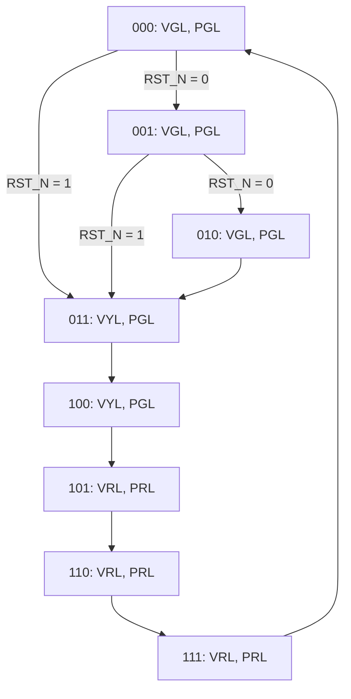

<!---

This file is used to generate your project datasheet. Please fill in the information below and delete any unused
sections.

You can also include images in this folder and reference them in the markdown. Each image must be less than
512 kb in size, and the combined size of all images must be less than 1 MB.
-->

## How it works

This project describes an **eight-state Moore finite state machine** for a traffic light controller. It has **three vehicle LEDs**, **two pedestrian LEDs**, and a binary input **`RST_N`** that affects the transitions from the first two states.

### 1. Inputs and outputs

#### Input

| Signal | Meaning |
|---|---|
| `RST_N` | Binary input that selects the next state while in states `000` and `001`. Minimize time for jump to Vehicle RED light and Pedestrian GREEN light.|

#### LED outputs

| Signal | Meaning |
|---|---|
| `VGL` | Vehicle Green Light |
| `VYL` | Vehicle Yellow Light |
| `VRL` | Vehicle Red Light |
| `PRL` | Pedestrian Red Light |
| `PGL` | Pedestrian Green Light |

**Signal convention:** In the tables below, `1` means the output is active (LED on) and `0` means inactive (LED off), assuming active-high LED driving.

### 2. States and output assignments — FSM

Because this is a Moore FSM, the five LED outputs depend on the current state, rather than directly on `RST_N`.

| State | Vehicle LEDs on | Pedestrian LED on | VGL | VYL | VRL | PGL | PRL |
|---|---|---|---:|---:|---:|---:|---:|
| `000` | Green | Red | 1 | 0 | 0 | 0 | 1 |
| `001` | Green | Red | 1 | 0 | 0 | 0 | 1 |
| `010` | Green | Red | 1 | 0 | 0 | 0 | 1 |
| `011` | Yellow | Red | 0 | 1 | 0 | 0 | 1 |
| `100` | Yellow | Red | 0 | 1 | 0 | 0 | 1 |
| `101` | Red | Green | 0 | 0 | 1 | 1 | 0 |
| `110` | Red | Green | 0 | 0 | 1 | 1 | 0 |
| `111` | Red | Green | 0 | 0 | 1 | 1 | 0 |

### 3. State transitions — FSM

| Current state | Input condition | Next state |
|---|---|---|
| `000` | `RST_N = 0` | `001` |
| `000` | `RST_N = 1` | `011` |
| `001` | `RST_N = 0` | `010` |
| `001` | `RST_N = 1` | `011` |
| `010` | Any `RST_N` | `011` |
| `011` | Any `RST_N` | `100` |
| `100` | Any `RST_N` | `101` |
| `101` | Any `RST_N` | `110` |
| `110` | Any `RST_N` | `111` |
| `111` | Any `RST_N` | `000` |

The input `RST_N` changes how quickly the FSM reaches state `011`, measured in state transitions; it does not directly change LED outputs while the current state stays the same.

## How to test

- When `RST_N = 0` at states `000` and `001`, the FSM continues through `000 → 001 → 010 → 011`.
  
- When `RST_N = 1` at states `000` or `001`, the FSM jumps directly to `011`, skipping any intervening early states.
  
- From `011` onward, it follows `011 → 100 → 101 → 110 → 111 → 000`, independently of `RST_N`.
  
- Each transition would occur on the designated clock edge.

## External hardware

Requires 5 LEDS. 2 RED LEDs, 2 GREEN LEDs and 1 YELLOW LED.
