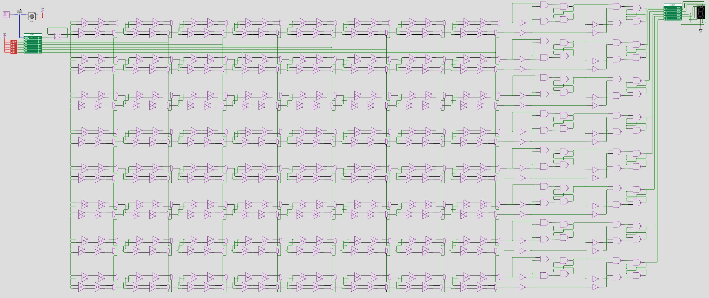

<!---

This file is used to generate your project datasheet. Please fill in the information below and delete any unused
sections.

You can also include images in this folder and reference them in the markdown. Each image must be less than
512 kb in size, and the combined size of all images must be less than 1 MB.
-->

## How it works

This is a physically unclonable function (PUF).
Instead of storing secret cryptographic keys in non-volatile memory (NVM), it generates keys on demand, 
These keys are generated from device fabrication variability called mismatch.
These variations are so small that they are extremely difficult to measure or reproduce.

A puf takes a challenge (input) and produces a unique response (output) associated to that particular puf.
A response and a challenge form a challenge response pair, these should be unique and reproducible.
- Unique, meaning the same challenge on different pufs should give different response, (since response are binary, they are ideally ~50% different).
- Reproducible, meaning that the same challenge on the same puf should always give the same response.

This specific design is an **arbiter puf**.
These generate a response by racing a rising edge between two different paths, depending on which arrives first, a `1` or a `0` is generated.
In this design, the racing paths are formed using n stages, each stage formed by 2 multiplexers (muxes), both mux under the same control bit (which corresponds to the challenge) and both racing paths connected to both muxes but if path is on the first input on one mux, is then connected on the second input on the other.

There are 8 digital inputs, so, 16 muxes are used to achieve 8 bit challenge, also, to add extra delay, and more mismatch to exploit, 2 inverters are added before each mux input path.
The racing edges first to arrive is detected using a D-type flip flop (DFF) with one racing path on the D input while the other on the clock. 
If the edge on the clock path arrives first, the D input is still `0` so the output is `0`.
If the edge on the D input arrives first, when the clock edge arrives, there is a signal on the D input and the output is `1`.
Because this puf is a 1-bit response puf, and, to make use of the tile area, 8 instances of the arbiter puf are added, all under the same challenge, resulting in a 8 bit response.
The responses are all connected to the digital outputs, so, they are displayed on the 7-segment display.

To generate the racing edge, a clock is used.
The clock goes through a DFF divider before launching the edge to keep the clock out of combinational logic.
Using a clock allows to test the reliability of the puf, as it should always output the same response for the different clock edges.

## How to test

1. Set the `clock` to 1 Hz (it's divided by 2 in the circuit). Changing the `clock` will change the racing edge frequency.
2. No reset required.
3. Set `ui[0]` (LSB) to `ui[7]` (MSB) to the desired challenge. Once a new challenge is set, it will take 2/(`clock` frequency) (2 s at 1Hz) to refresh.
4. Each segment shows one response bit, a lit segment means `1`. The input to 7-segment display map is shown on the table below.
5. Reliability test: Keep the same challenge for several `clock` edges, the responses should stay the same.
6. Reproducibility test: Note the challenge response pair, change the challenge and go back to the same challenge (can be tested on different days to make sure it keeps the reproducibility). The response should stay the same.

|Pin|Response bit|Segment|
|---|---|---|
|uo[0]|"RESPONSE[0]"|(SEG_A)|
|uo[1]|"RESPONSE[1]"|(SEG_B)|
|uo[2]|"RESPONSE[2]"|(SEG_C)|
|uo[3]|"RESPONSE[3]"|(SEG_D)|
|uo[4]|"RESPONSE[4]"|(SEG_E)|
|uo[5]|"RESPONSE[5]"|(SEG_F)|
|uo[6]|"RESPONSE[6]"|(SEG_G)|
|uo[7]|"RESPONSE[7]"|(SEG_DP)|
